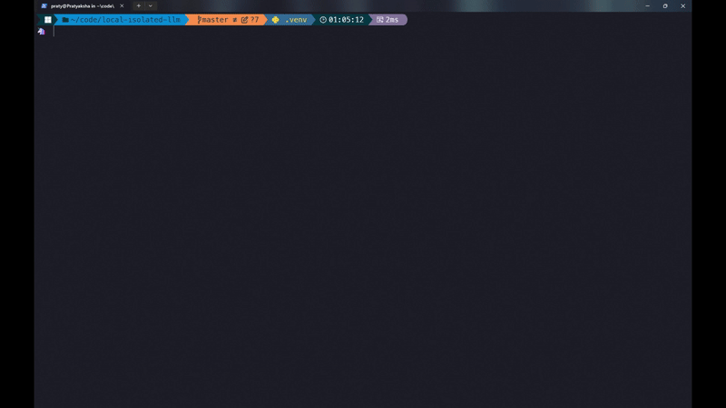

# Local And Isolated LLM
This project lets you run Large Language Models (LLMs) on your own machine using Hugging Face Transformers. No need for cloud services, just load up the model locally and get started. It's perfect for quick experiments, prototyping, or building cool AI apps without losing control or privacy.

Features:
- Run models locally for super fast responses.
- Full control over how the model runs and what it does.
- Simple CLI to chat with the model.

# Setup
- Create a python virtual environment: `python -m venv .venv`
- Activate the virtual environment: `.venv\Scripts\activate`
- Download the dependencies: `python -m pip install -r requirements.txt`
- Run the script: `python run_llm.py`

# Demo

# Architecture

local-llm
│
├── frontend
│   ├── tui
│   └── webui
│
├── api
│
├── model_registry
│
├── runtimes
│   ├── llama_cpp
│   ├── transformers
│   ├── vllm
│   └── ollama (optional)
│
├── storage
│
└── plugins     

data/
├── models/
│   ├── manifests/
│   │   ├── qwen3.yaml
│   │   └── gemma3.yaml
│   │
│   ├── cache/
│   │   ├── qwen3/
│   │   └── gemma3/
│   │
│   └── downloads/
│
├── chats/
│
└── settings/

# file structure
local-llm/
│
├── pyproject.toml
├── README.md
├── .env
│
├── app/
│   │
│   ├── main.py
│   │
│   ├── api/
│   │   ├── server.py
│   │   ├── dependencies.py
│   │   │
│   │   └── routes/
│   │       ├── chat.py
│   │       ├── models.py
│   │       ├── downloads.py
│   │       ├── settings.py
│   │       ├── tools.py
│   │       └── health.py
│   │
│   ├── services/
│   │   ├── chat_service.py
│   │   ├── model_service.py
│   │   ├── runtime_service.py
│   │   ├── download_service.py
│   │   ├── settings_service.py
│   │   └── session_service.py
│   │
│   ├── registry/
│   │   ├── model_registry.py
│   │   ├── runtime_registry.py
│   │   ├── tool_registry.py
│   │   └── plugin_registry.py
│   │
│   ├── runtimes/
│   │   ├── base.py
│   │   │
│   │   ├── llama_cpp/
│   │   │   └── runtime.py
│   │   │
│   │   ├── transformers/
│   │   │   └── runtime.py
│   │   │
│   │   ├── vllm/
│   │   │   └── runtime.py
│   │   │
│   │   └── external/
│   │       └── runtime.py
│   │
│   ├── llm/
│   │   ├── generation.py
│   │   ├── streaming.py
│   │   ├── prompt_builder.py
│   │   ├── conversation.py
│   │   └── tokenization.py
│   │
│   ├── templates/
│   │   ├── base.py
│   │   ├── chatml.py
│   │   ├── llama3.py
│   │   ├── gemma.py
│   │   └── custom.py
│   │
│   ├── downloads/
│   │   ├── huggingface.py
│   │   ├── local_import.py
│   │   └── validation.py
│   │
│   ├── tools/
│   │   ├── base.py
│   │   ├── calculator.py
│   │   ├── filesystem.py
│   │   └── shell.py
│   │
│   ├── storage/
│   │   ├── database.py
│   │   ├── repositories/
│   │   │   ├── chats.py
│   │   │   ├── messages.py
│   │   │   ├── models.py
│   │   │   └── settings.py
│   │   │
│   │   └── migrations/
│   │
│   ├── tui/
│   │   ├── app.py
│   │   │
│   │   ├── screens/
│   │   │   ├── chat.py
│   │   │   ├── models.py
│   │   │   ├── downloads.py
│   │   │   └── settings.py
│   │   │
│   │   └── widgets/
│   │
│   ├── webui/
│   │   ├── static/
│   │   ├── templates/
│   │   └── frontend/
│   │
│   └── core/
│       ├── config.py
│       ├── logging.py
│       ├── events.py
│       ├── exceptions.py
│       └── constants.py
│
├── plugins/
│   │
│   ├── runtimes/
│   │   └── README.md
│   │
│   ├── tools/
│   │   └── README.md
│   │
│   └── templates/
│       └── README.md
│
├── data/
│   │
│   ├── database/
│   │   └── app.db
│   │
│   ├── models/
│   │   │
│   │   ├── manifests/
│   │   │   ├── qwen3.yaml
│   │   │   ├── gemma3.yaml
│   │   │   └── custom-model.yaml
│   │   │
│   │   ├── cache/
│   │   │   ├── qwen3/
│   │   │   └── gemma3/
│   │   │
│   │   └── downloads/
│   │
│   ├── chats/
│   │
│   ├── logs/
│   │
│   └── embeddings/
│
├── config/
│   │
│   ├── app.yaml
│   ├── models.yaml
│   ├── runtimes.yaml
│   └── tools.yaml
│
├── scripts/
│   ├── install_model.py
│   ├── remove_model.py
│   ├── benchmark.py
│   └── migrate.py
│
├── tests/
│   ├── api/
│   ├── runtimes/
│   ├── registry/
│   ├── services/
│   └── integration/
│
└── docs/
    ├── architecture.md
    ├── plugin-system.md
    ├── runtimes.md
    └── model-manifests.md

Key architectural decisions
1. Models are data, not code

Avoid:

app/models/qwen.py
app/models/gemma.py

Instead:

data/models/manifests/*.yaml

Example:

id: qwen3-8b

name: Qwen3 8B

runtime: llama_cpp

source:
  provider: huggingface
  repo: Qwen/Qwen3-8B-Instruct

chat_template: chatml

parameters:
  context_length: 32768

Adding a new model should never require a code change.

2. Runtime abstraction

Every backend implements:

class Runtime:
    load()
    unload()
    generate()
    stream()

Supported examples:

llama.cpp
transformers
vLLM
external OpenAI-compatible endpoint
3. Registry pattern

The registry discovers:

models
runtimes
tools
templates
plugins

at startup.

runtime = runtime_registry.get("llama_cpp")
model = model_registry.get("qwen3")
4. TUI and WebUI are clients

Neither should know how models work.

TUI
  ↓
REST API
  ↓
Services
  ↓
Runtime

This lets you later:

Run only the API
Run only the TUI
Run only the web server
Expose a local OpenAI-compatible endpoint

without changing internals.

5. Leave room for future capabilities

Even if you don't implement them now, reserve directories for:

embeddings/
rag/
agents/
plugins/

It's much easier than restructuring later once users start installing custom models and tools.

# Note
- If you have GPU, ensure that CUDA toolkit is installed.